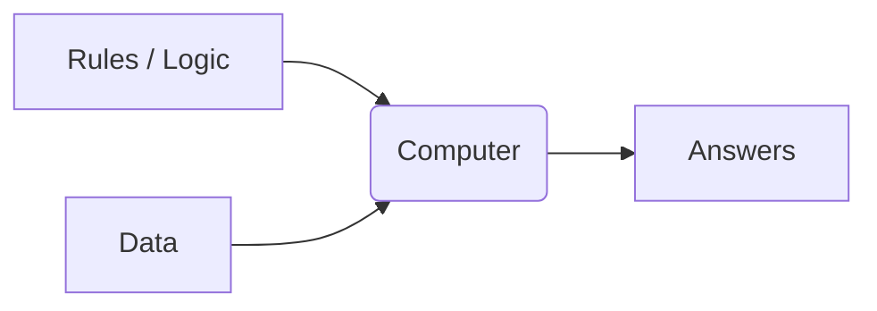
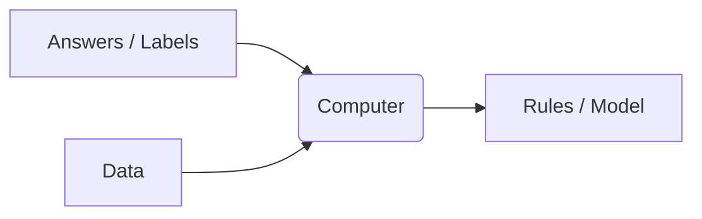

#  What is Machine Learning?

Machine Learning (ML) is a subset of Artificial Intelligence (AI) that focuses on building systems that learn—or improve performance—based on the data they consume.

## Traditional Programming vs. Machine Learning

To understand ML, it's helpful to compare it to traditional programming.

###  Traditional Programming
In traditional programming, you provide the **Rules** (code) and the **Data**, and the computer gives you the **Answers**.

###  Machine Learning
In Machine Learning, you provide the **Data** and the **Answers**, and the computer discovers the **Rules**.

Once the rules (the model) are learned, you can apply them to *new* data to get predictions!

## Why do we need Machine Learning?
Some problems are simply too complex to write explicit rules for. For example, how would you write a rule to predict if a Bigkart customer will buy strawberry ice cream or chocolate ice cream? 
- "If they are younger than 12..." (Adults like strawberry too).
- "If they bought fruit yesterday..." (They might want chocolate today).

Instead of writing thousands of complex `if/else` statements, we simply feed the machine thousands of Bigkart purchase histories, and let it figure out the patterns and rules itself!

--- 
algorithms to cover
- [Deep-Learning](http://localhost:3000/docs/Python/Python%203-%20Algorithms/Machine-Learning/K-Means#)
    [Attention](http://localhost:3000/docs/Python/Python%203-%20Algorithms/Deep-Learning/Attention)
        - [GPT](http://localhost:3000/docs/Python/Python%203-%20Algorithms/Deep-Learning/GPT)
        - [Transformers](http://localhost:3000/docs/Python/Python%203-%20Algorithms/Deep-Learning/Transformers)
    - [Information-Retrieval](http://localhost:3000/docs/Python/Python%203-%20Algorithms/Machine-Learning/K-Means#)
        - [BM25](http://localhost:3000/docs/Python/Python%203-%20Algorithms/Information-Retrieval/BM25)
        - [HNSW](http://localhost:3000/docs/Python/Python%203-%20Algorithms/Information-Retrieval/HNSW)
        - [Hybrid Search](http://localhost:3000/docs/Python/Python%203-%20Algorithms/Information-Retrieval/Hybrid-Search)
        - [Vector Search](http://localhost:3000/docs/Python/Python%203-%20Algorithms/Information-Retrieval/Vector-Search)
    - [Machine-Learning](http://localhost:3000/docs/Python/Python%203-%20Algorithms/Machine-Learning/K-Means#)
        - [K-Means](http://localhost:3000/docs/Python/Python%203-%20Algorithms/Machine-Learning/K-Means)
        - [Linear Regression](http://localhost:3000/docs/Python/Python%203-%20Algorithms/Machine-Learning/Linear-Regression)
        - [Naive Bayes](http://localhost:3000/docs/Python/Python%203-%20Algorithms/Machine-Learning/Naive-Bayes)