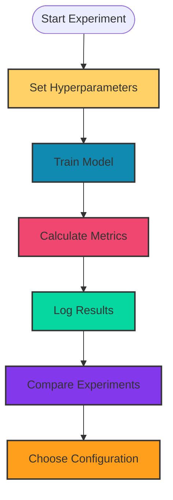

# 1. Experiment Tracking

Experiment tracking means recording what happened during each training run.

It helps compare different models, hyperparameters, and results.

## What to Track

- Learning rate
- Batch size
- Number of epochs
- Model architecture
- Loss
- Accuracy
- Validation metrics
- Regularization settings

## Why Use It?

Without tracking:

```text
Change something
      ↓
Train again
      ↓
Better or worse?
      ↓
Forgot what changed
```

With tracking:



## Simple Experiment Tracking

A simple dictionary can track experiments.

```python
experiment = {
    "learning_rate": 0.001,
    "batch_size": 32,
    "epochs": 100,
    "hidden_size": 10,
    "dropout": 0.2,
    "final_loss": 0.42
}

print(experiment)
```

## Tracking Multiple Experiments

```python
experiments = []

experiment = {
    "learning_rate": 0.001,
    "hidden_size": 10,
    "final_loss": 0.42
}

experiments.append(experiment)
```

## Actual Implementation

```python
import torch
import torch.nn as nn

class NeuralNetwork(nn.Module):
    def __init__(self, hidden_size):
        super().__init__()

        self.linear1 = nn.Linear(2, hidden_size)
        self.linear2 = nn.Linear(hidden_size, 1)

    def forwardpass(self, x):
        x = torch.relu(self.linear1(x))
        x = self.linear2(x)

        return x


inputs = torch.tensor([
    [18.0, 28.0],
    [19.0, 29.0],
    [20.0, 30.0],
    [21.0, 31.0]
])

targets = torch.tensor([
    [18.0],
    [19.0],
    [20.0],
    [21.0]
])

experiments = []

for learning_rate in [0.001, 0.01]:

    model = NeuralNetwork(hidden_size=10)

    optimizer = torch.optim.SGD(
        model.parameters(),
        lr=learning_rate
    )

    loss_function = nn.MSELoss()

    for epoch in range(100):

        optimizer.zero_grad()

        output = model.forwardpass(inputs)

        loss = loss_function(output, targets)

        loss.backward()

        optimizer.step()

    experiment = {
        "learning_rate": learning_rate,
        "hidden_size": 10,
        "epochs": 100,
        "final_loss": loss.item()
    }

    experiments.append(experiment)

print(experiments)
```

## Quick Difference

```text
Experiment Tracking → Record what was tried and what happened

Hyperparameters → What you changed
Metrics          → What you measured
Experiments      → Different training configurations
```
