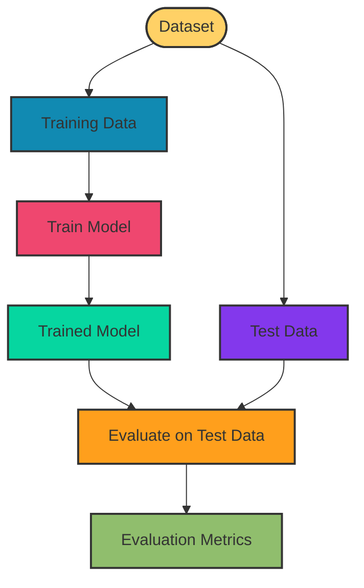

# 2. Model Evaluation

Model evaluation means checking how well a trained model performs on unseen data.

The model should be evaluated on data it did not train on.

## Train vs Test



## Common Metrics

| Metric | Meaning |
| --- | --- |
| MSE | Average squared prediction error |
| MAE | Average absolute prediction error |
| Accuracy | Percentage of correct predictions |
| Precision | How many predicted positives were actually positive |
| Recall | How many actual positives were correctly found |
| F1 Score | Balance between Precision and Recall |

## Train and Evaluation Mode

During evaluation, disable training-specific behavior such as Dropout.

```python
model.eval()
```

Disable gradient calculation because weights are not being updated.

```python
with torch.no_grad():
    output = model(inputs)
```

## Actual Implementation

```python
import torch
import torch.nn as nn

class NeuralNetwork(nn.Module):
    def __init__(self):
        super().__init__()

        self.linear1 = nn.Linear(2, 10)
        self.dropout = nn.Dropout(0.2)
        self.linear2 = nn.Linear(10, 1)

    def forward(self, x):
        x = torch.relu(self.linear1(x))
        x = self.dropout(x)
        x = self.linear2(x)

        return x


model = NeuralNetwork()

inputs = torch.tensor([
    [18.0, 28.0],
    [19.0, 29.0],
    [20.0, 30.0],
    [21.0, 31.0]
])

targets = torch.tensor([
    [18.0],
    [19.0],
    [20.0],
    [21.0]
])

loss_function = nn.MSELoss()

# Evaluation mode
model.eval()

# No gradients during evaluation
with torch.no_grad():

    predictions = model(inputs)

    test_loss = loss_function(
        predictions,
        targets
    )

print("Test Loss:", test_loss.item())
```

## Quick Difference

```text
Training   → Update model weights
Evaluation → Measure model performance
model.train() → Training mode
model.eval()  → Evaluation mode
no_grad()     → Don't calculate gradients
```
