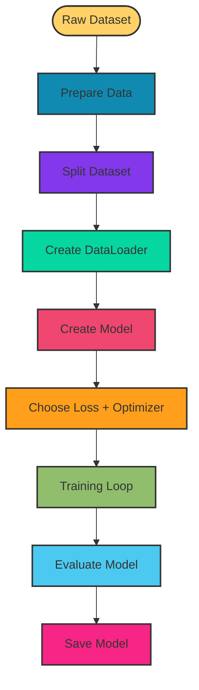

# 4. Training Pipelines

A training pipeline is the complete process used to prepare data, train a model, evaluate it, and save the trained model.

## Basic Training Pipeline



## Main Steps

| Step | Purpose |
| --- | --- |
| Data Preparation | Clean and transform data |
| Dataset Split | Create training and validation/test sets |
| DataLoader | Load data in batches |
| Model | Define neural network |
| Loss Function | Measure prediction error |
| Optimizer | Update model weights |
| Training | Learn from training data |
| Evaluation | Measure performance on unseen data |
| Saving | Store trained model |

## Training Loop

The training loop usually contains:

```python
for epoch in range(epochs):
    model.train()

    for inputs, targets in train_loader:
        outputs = model(inputs)
        loss = criterion(outputs, targets)

        optimizer.zero_grad()
        loss.backward()
        optimizer.step()
```

## Evaluation Loop

```python
model.eval()

with torch.no_grad():
    for inputs, targets in test_loader:
        outputs = model(inputs)
        loss = criterion(outputs, targets)
```

## Why Use a Pipeline?

A pipeline makes training:

- Repeatable
- Organized
- Easier to debug
- Easier to experiment with
- Easier to deploy

## Actual Implementation

```python
import torch
import torch.nn as nn
import torch.optim as optim
from torch.utils.data import TensorDataset, DataLoader

# 1. Prepare data
X = torch.tensor([[1.0], [2.0], [3.0], [4.0], [5.0], [6.0]])
y = torch.tensor([[2.0], [4.0], [6.0], [8.0], [10.0], [12.0]])

# 2. Split data
X_train, X_test = X[:4], X[4:]
y_train, y_test = y[:4], y[4:]

# 3. Create DataLoader
train_dataset = TensorDataset(X_train, y_train)
train_loader = DataLoader(train_dataset, batch_size=2, shuffle=True)

test_dataset = TensorDataset(X_test, y_test)
test_loader = DataLoader(test_dataset, batch_size=2)

# 4. Create model
class NeuralNetwork(nn.Module):
    def __init__(self):
        super().__init__()
        self.linear = nn.Linear(1, 1)

    def forward(self, x):
        return self.linear(x)

model = NeuralNetwork()

# 5. Loss + optimizer
criterion = nn.MSELoss()
optimizer = optim.SGD(model.parameters(), lr=0.01)

# 6. Training
for epoch in range(1000):
    model.train()

    for inputs, targets in train_loader:
        outputs = model(inputs)
        loss = criterion(outputs, targets)

        optimizer.zero_grad()
        loss.backward()
        optimizer.step()

# 7. Evaluation
model.eval()

with torch.no_grad():
    total_loss = 0

    for inputs, targets in test_loader:
        outputs = model(inputs)
        loss = criterion(outputs, targets)
        total_loss += loss.item()

print("Test Loss:", total_loss)

# 8. Save model
torch.save(model.state_dict(), "model.pth")
```
