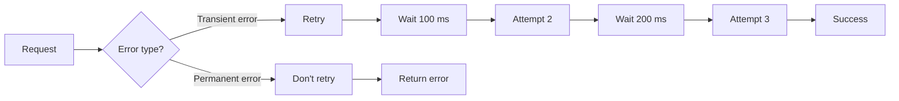

## 1.- Reliability
### 1.1 retries
Use **bounded retries with exponential backoff**.

### 1.2 Timeouts

| Main concept                     | set timeout for everything API timeout: 30 sec Retriever timeout: 2 sec LLM timeout: 20 sec                                                                                                                                                                                                                                                                                 |
| -------------------------------- | --------------------------------------------------------------------------------------------------------------------------------------------------------------------------------------------------------------------------------------------------------------------------------------------------------------------------------------------------------------------------- |
| fallback models (generation)  | have high quality primary model and low quality secondary model which can scale a lot in case primary model is overloaded                                                                                                                                                                                                                                                   |
| graceful failure (retreival)  | specially important in case retreival side failed this means that generation side will have to handle it. Instead of having a hallucinated answer being generated, generate a fallback.  lets say vector db crashed so entire retreival crashed.  Retrieval failed -> Don't generate unsupported answer -> Safe response        |
| circuit breakers                 | if multiple services access a dependency which is failing, to prevent cascading failures, use CB, here we open the CB to make the request reroute to other channel, After some time: make it half open, test the request and close it only if the dependency starts working.  CB Open state -> dependency wont be used.  reroute CB Closed state -> dep will be used. |
| Bounded Retries (API Failure) | Use **bounded retries with exponential backoff**. (explained above)                                                                                                                                                                                                                                                                                                         |

## 2 Security

| authentication             | Login Logout                                                                                                                                   |
| -------------------------- | ---------------------------------------------------------------------------------------------------------------------------------------------- |
| authorization              | Access Level                                                                                                                                   |
| tenant isolation           | hard isolate saperate companies, soft isolate every document with department_id for soft isolating within departments during document cleaning |
| encryption                 | at rest the storing facility should be encrypted like entire database, in transit the message should be encrypted, eg. api response contents.  |
| PII protection             | personally identifiable information should be prevented as output from llm, eg. mask the phone no. in data cleaning step and prompt formatting |
| permission-aware retrieval |                                                                                                                                                |
## 3 Scalability

| horizontal scaling     | on load dont make single server bigger, add new servers instead                                                                                                                                                  |
| ---------------------- | ---------------------------------------------------------------------------------------------------------------------------------------------------------------------------------------------------------------- |
| asynchronous ingestion | Let background workers handle the async ingestion process while the RAG can still be used                                                                                                                        |
| caching                | cache the input-output pair for next time same input, but keep authorization in mind.                                                                                                                            |
| batch embedding        | instead of feeding each chunk at a time to become a vector, feed multiple chunks in a single batch to become vector at once, that is better coz less network call, lower cost.                                   |
| scalable vector search | This is in case the RAG is too big like 100 M documents solutions -> - approximate nearest-neighbor indexes - sharding - filtering - partitioning - replication - distributed vector databases |

## 4 Observability

| retrieval latency                       | measure retreival latency using timeout. if it hits many times there is a retreival issue                                                      |
| --------------------------------------- | ---------------------------------------------------------------------------------------------------------------------------------------------- |
| end-to-end latency                      | used for model performance, prompt size, api load                                                                                              |
| token usage                             |                                                                                                                                                |
| cost/request                            |                                                                                                                                                |
| retrieval relevance                     | - Precision@K - Recall@K - MRR - NDCG know Precision@K and Recall@K                             |
| error rate                              | instead of error req % of total req, segregate it further like ->  retrieval error authentication error rate limit tool failure |
| Answer Quality &  hallucination rate | this is passed req but is wrong factually. thumbs up and down helps gather the data. Reduce by prompting                                       |

## 5 Evaluation

**Retrieval** > Did we retrieve the right information?
Generation Did the LLM produce the correct answer using that information?

